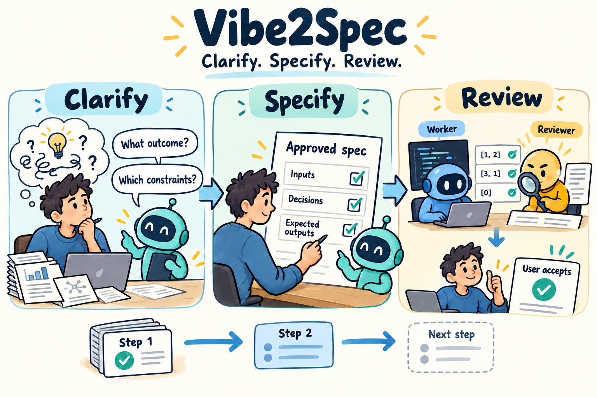

# Vibe2Spec

Turn an idea into a specification you can approve, implement, and verify.



Vibe2Spec is being built to turn developer and researcher requests into precise,
user-approved steps. It asks about missing decisions, explains the options,
and records what the worker must follow. Each step receives its own
specification and reviews before the project advances.

Planned integrations: Claude Code and Codex. The current repository contains
the record format, specification templates, fictional record examples, and
development evidence. An installable Vibe2Spec plugin and automated helpers
are still in development. The cartoon illustrates the intended workflow.

[See the example](#one-request-many-decisions-one-explicit-specification) ·
[Get started](#quick-start) · [Follow the workflow](#one-step-at-a-time) ·
[Read the roadmap](#development-roadmap)

## One request. Many decisions. One explicit specification.

Suppose you ask:

> Write a function that keeps numbers above a threshold.

That request leaves several choices open. Does a number equal to the threshold
stay? Does the output preserve the input order? What happens when a value is
missing? These choices change the function's behavior and its downstream use.

The following is an illustrative conversation for the planned workflow.
It is not output from an implemented Vibe2Spec command. Its values and answers
do not approve work in a real project.

> When a number equals the threshold, should it be retained? For the input
> `[-1, 0, 2, 2, 5]` and threshold `2`, an inclusive rule returns `[2, 2, 5]`.
> A strict rule returns `[5]`. The inclusive rule is appropriate when the
> threshold means the minimum acceptable value. The strict rule requires every
> retained value to exceed that minimum. Which meaning do you intend?

Imagine you choose the inclusive rule. The conversation then explains other
independent settings together. For example:

> The retained values can stay in their original order or be sorted. With input
> `[5, 1, 2, 2]` and threshold `2`, preserving order returns `[5, 2, 2]`.
> Sorting in ascending order returns `[2, 2, 5]`. Preserving order retains the
> sequence in which observations appeared. Sorting makes values easier to read
> by magnitude, but changes that sequence. Does the original sequence matter
> to the next part of your analysis?

The other settings need equally concrete explanations. A grouped review keeps
each decision's context, consequences, and examples visible. You can approve
some settings and leave others unresolved. A difficult decision receives an
individual question when its answer determines what to ask next.

Imagine you also choose to retain repeated values and preserve input order.
The proposed checks could then include these small, known examples:

| Input | Threshold | Expected output |
| --- | ---: | --- |
| `[-1, 0, 2, 2, 5]` | 2 | `[2, 2, 5]` |
| `[2]` | 2 | `[2]` |
| `[1]` | 2 | `[]` |
| `[]` | 2 | `[]` |
| `[5, 1, 2, 2]` | 2 | `[5, 2, 2]` |

These examples make the selected behavior visible. The full specification
still needs the interface, permitted inputs, invalid-input behavior, input
mutation policy, comparison rules, and execution limits. Input mutation means
changing the original array supplied by the caller. Missing decisions return
to the interview before implementation begins.

```text
"Keep numbers above a threshold"
                 |
                 v
+-----------------------------------------------------------+
| Explain the decisions                                     |
| Equality, ordering, repeated values, invalid input,        |
| changes to the original array, and small paired checks.    |
+-----------------------------------------------------------+
                 |
                 v
+-----------------------------------------------------------+
| Record the complete current-step specification            |
| Exact behavior, approved settings, expected outputs,      |
| implementation units, checks, and execution limits.        |
+-----------------------------------------------------------+
                 |
        User approval + separate specification review
                 |
                 v
       Prepare code -> Review code and settings
                 |
                 v
          Execute -> Check and review results
                 |
                 v
          User accepts -> Step finished
```

[Read the full illustrated interview](docs/illustrative-example.md), including
data loss, input changes, uncertain answers, and paired function checks.

<details>
<summary>See how an answer becomes a specification requirement</summary>

A readable specification uses a named requirement and concrete scenarios:

```text
Requirement: Inclusive threshold filtering

The function SHALL retain each permitted numeric input value that is
greater than or equal to the supplied threshold. It SHALL preserve the
relative order and multiplicity of retained values.

Scenario: Values equal to the threshold
WHEN the input is [-1, 0, 2, 2, 5] and the threshold is 2
THEN the returned array is exactly [2, 2, 5].

Scenario: Retained values are not already sorted
WHEN the input is [5, 1, 2, 2] and the threshold is 2
THEN the returned array is exactly [5, 2, 2].
```

This excerpt describes only the illustrated choices. A complete step also
links each requirement to its decision, approval, and check. Its unit contract
fixes all behavior needed to implement that function. The excerpt alone cannot
authorize implementation.

</details>

## Quick start

The current version is a documentation and template prototype. You can read
the worked example and inspect the record format without installing a runtime.
To explore a local copy, use Git:

```sh
git clone --branch main https://github.com/bao96-bioinfo/Vibe2Spec.git
cd Vibe2Spec
```

Start with the [worked example](docs/illustrative-example.md), then open the
[project template](templates/project.md) and
[step specification template](templates/step/spec.md). The
[record-format guide](docs/record-format.md) defines the structured fields and
the evidence needed to approve, review, and finish a step.

For a manual exploration with your coding agent, you can use this prompt:

> Read `docs/illustrative-example.md` and `docs/record-format.md`. My goal is
> [describe your goal]. Begin by clarifying the intended outcome and missing
> constraints. Explain the options with concrete examples. Keep unresolved
> decisions visible and wait for my explicit choices before writing a complete
> current-step specification. Do not begin implementation while it is incomplete.

This is an ordinary prompt using the repository's documents. There is no
Vibe2Spec installation command, executable coordinator, or automated review
integration yet. Node.js helpers and host packages appear in the roadmap below.
The generated OpenSpec files in `.agents/` and `.claude/` support development
of this repository; they are not the planned Vibe2Spec package.

## One step at a time

The overall plan describes the project's destination and dependencies. Detailed
specifications are developed as each step becomes current. Later steps remain
provisional until the current step passes its checks and review and you
explicitly accept its results.

```text
Clarify the goal and agree on the project overview
                         |
                         v
              +---------------------+
              | Select current step |<---------------------------+
              +---------------------+                            |
                         |                                       |
                         v                                       |
              Interview and research                             |
                         |                                       |
              Write the complete specification                   |
                         |                                       |
              User approval + specification review               |
                         |                                       |
              Prepare implementation                             |
                         |                                       |
              Review code, commands, and effective settings       |
                         |                                       |
              Execute the reviewed work                          |
                         |                                       |
              Check outputs + separate results review            |
                         |                                       |
              Obtain explicit user acceptance                    |
                         |                                       |
              Preserve the accepted step as finished              |
                         |                                       |
                  More steps remain? ---- yes -------------------+
                         |
                         no
                         v
                 Project completed
```

An uncovered choice pauses the affected work and returns it to the interview.
This includes an omitted function argument, a library default, an environment
override, or a fallback that changes behavior. A familiar convention or a
recommendation does not supply user approval.

Completed steps retain their accepted contents. A necessary correction requires
an amendment explaining why progress needs it. The amendment identifies every
affected script and other artifact, each planned edit, and downstream effects.
You approve that exact scope before the step is reopened. The revised step
repeats specification, review, implementation, and acceptance. Affected dependent
work remains suspended until its evidence is valid again.

## Three reviews, distinct responsibilities

A reviewer works in a separate context from the authors of the artifacts being
assessed. It receives the actual specification, prepared work, or execution
evidence needed for its review. The worker's summary alone is insufficient.

| Review | What it establishes | What keeps work pending |
| --- | --- | --- |
| Specification review, before implementation | The current step and its units are complete, consistent, approved, and testable. | A missing decision, unclear requirement, unapproved setting, or uncovered output. |
| Pre-execution review | The actual code, commands, configuration, and effective settings follow the approved specification. | A silently used default, extra argument, changed work, or unsupported assumption. |
| Results review | The actual run and outputs match the reviewed work and pass the approved checks. | Failed checks, missing evidence, changed inputs, or unapproved comparison criteria. |

If native delegation is unavailable, the workflow requests a separate review
session. The relevant gate remains pending until a passing review is available.
Checks and review must pass before the user can accept a step as finished.

The planned first release uses instructions, records, and review to control
execution. These controls are not an operating-system sandbox. Their reliability
depends on agents following the workflow and reviewers examining adequate evidence.

## Same specified behavior. Explicit comparison rules.

Two implementations may have different source code. They should exhibit the same
specified behavior and produce matching outputs under the approved comparison
rules. Each output needs a rule before execution.

| Comparison | Meaning | Decisions that must be explicit |
| --- | --- | --- |
| Exact bytes | Every byte is identical. | File encoding, formatting, line endings, and other output details that affect bytes. |
| Exact JSON | Structured values match exactly. Arrays preserve order; object key order is ignored. | Value types, array order, and supported numeric representations. |
| Numerical | Values satisfy an approved mathematical comparison. | Metric, tolerance, inclusive or exclusive boundary, alignment, zero handling, and missing or non-finite values. |

For illustration, an absolute-error limit of `0.001` could accept `1.0005`
against a reference of `1.0000` and reject `1.0020`. A complete rule must also
say what happens exactly at the boundary. The user must approve the rule and
its value; this example establishes no default tolerance.

Each step explicitly decides whether to use paired validation. In paired
validation, two independent workers implement the same small unit from the same
complete approved specification. Both receive the same saved synthetic inputs.
Each result is checked against its expected value, and the two results are also
compared directly.

```text
                    Same approved unit specification
                    Same small, saved input vector
                              /           \
                             v             v
                         Worker A       Worker B
                             |             |
                         Output A       Output B
                             |             |
                     Check each against expected output
                              \           /
                               v         v
                         Compare A directly with B
```

For input `[5, 1, 2, 2]`, the illustrated filtering rule expects `[5, 2, 2]`.
Two workers returning `[5]` agree with each other but both fail correctness.
Small paired checks can expose ambiguity and implementation differences.
They do not prove equivalence for every input or establish scientific validity.
This workflow does not require duplicating a large model training run.
Paired small-unit examples are required for the planned release examples.

## A research project starts with research questions

For a request such as “I want to publish a paper,” Vibe2Spec's planned interview
first establishes the research topic, intended contribution, and target venue.
It gathers relevant literature and explains feasible options when the user is
unsure. Dataset access, evaluation design, computing resources, cost, storage,
and time can all constrain the plan.

An illustrative overview, after those questions have been resolved, might be:

```text
Data preparation -> Evaluation design -> Baselines -> Proposed method
                                                            |
                                                            v
Manuscript <- Figures and tables <- Interpretation <- Experiments
```

The actual steps depend on the approved research objective. The overview does
not approve a dataset, filtering threshold, model, or training configuration.
When data preparation becomes current, the interview resolves its sources,
download directory, preprocessing operations, exclusion criteria, expected
artifacts, and checks before a worker prepares code.

Source findings, recommendations, and user choices remain distinct. If evidence
is inaccessible or contradictory, that limitation remains visible. An uncertain
answer leads to more explanation, targeted research, or a narrower question.

## Readable specifications with traceable records

Markdown documents explain the intent and behavior. JSON, a structured text
format, stores named fields for decisions, approvals, reviews, and results.
A reference includes the file path and a SHA-256 digest, a fingerprint of its
exact contents.

| Files available now | Purpose |
| --- | --- |
| [Record format](docs/record-format.md) | Defines the fields, states, references, comparisons, and authority of each record. |
| [Project documents](templates/project.md) and [project record](templates/project.json) | Describe the overview, ordered steps, current state, and project settings. |
| [Decision](templates/decision.json), [evidence](templates/evidence.json), and [approval](templates/approval.json) templates | Separate options and selected values from supporting sources and explicit user approval. |
| [Step templates](templates/step/) | Separate behavior, design, tasks, the complete step contract, and small unit contracts. |
| [Review](templates/review.json), [run](templates/run.json), and [comparison](templates/comparison.json) templates | Connect assessments and observed outputs to exact work and approved checks. |
| [Acceptance](templates/acceptance.json), [amendment](templates/amendment.json), and [snapshot](templates/snapshot.json) templates | Preserve accepted results, necessary reopening scope, and historical versions. |
| [Record fixtures](tests/fixtures/records/README.md) | Provide fictional complete and incomplete examples with expected findings. |

Drafts remain editable. Every version presented to the user or a reviewer is
preserved before later editing. A preserved or frozen version is not automatically
approved. Approval identifies the exact contents and scope the user accepted.

Workflow fields have fixed definitions. Project-specific settings occupy a
separate section and refer to decision records. Unresolved values remain visible;
they cannot become implicit permission to implement.

The record fixtures are fictional. Their stored commands, responses, reviews,
and acceptance records do not describe real execution or authorize work.

## See what has been verified

Development Step 1 delivered twenty format, template, and fixture files. Its
recorded read-only verification checked JSON parsing, byte formatting, file
identities, and content fingerprints. Separate review assessed the specified
requirements and all twenty-four fixture cases manually.

The [results review](openspec/changes/add-vibe2spec-guided-workflow/steps/01-records-and-templates/evidence/results-review-v1.md)
reports passing checks and no unresolved findings. Explicit user acceptance of
the Step 1 results remains pending, so the step is not marked finished. The
verification establishes the documented scope only. Automated record validation,
paired executions, and live plugin installation checks have not been implemented.

The [recorded command and run evidence](openspec/changes/add-vibe2spec-guided-workflow/steps/01-records-and-templates/evidence/)
document that specific approved verification. They are historical evidence;
there is no general product test command yet.

## Development roadmap

Each group follows the same interview, specification, review, and acceptance
cycle. The [task tracker](openspec/changes/add-vibe2spec-guided-workflow/tasks.md)
contains the detailed planned deliverables.

| Step | Deliverable | Current status |
| --- | --- | --- |
| 1 | Record format, Markdown and JSON templates, and fictional record fixtures. | Implemented and reviewed; result acceptance pending. |
| 2 | Node.js helpers for structural validation, snapshots, and readiness checks. | Planned. |
| 3 | Interview and research instructions with explanatory dialogue examples. | Planned. |
| 4 | Current-step authoring instructions and ASCII overview generation. | Planned. |
| 5 | Worker handoffs and separate specification, pre-execution, and results reviews. | Planned. |
| 6 | Small paired-unit validation and approved comparison helpers. | Planned. |
| 7 | Step completion, session resume, and necessary reopening. | Planned. |
| 8 | Claude Code and Codex packages with verified installation documentation. | Planned. |
| 9 | Paired release examples and integrated workflow verification. | Planned. |

Supported runtime and host versions will be fixed and verified during their
own implementation steps. Marketplace submission follows release acceptance
and separate publication authorization.

## Design foundations

Vibe2Spec draws on [OpenSpec](https://github.com/Fission-AI/OpenSpec) and
[GitHub Spec Kit](https://github.com/github/spec-kit). Its specifications use
named requirements, explicit scenarios, and separate behavior, design, and task
documents. Vibe2Spec adds exact decision approval, output comparison rules,
independent review, and preserved step acceptance to support reproducible work.

The intended runtime is standalone. OpenSpec and Spec Kit are design references,
and OpenSpec currently supports this repository's development process.
[SpecViz](https://github.com/bao96-bioinfo/SpecViz) inspired this README's cartoon,
example-first structure, and text diagrams. SpecViz is not a runtime dependency.
The writing conventions are incorporated into the project documents.

## Explore further

| Resource | What you will find |
| --- | --- |
| [Illustrative interview](docs/illustrative-example.md) | Concrete decision explanations and a small function example. |
| [Record-format guide](docs/record-format.md) | The complete current record contract. |
| [Release proposal](openspec/changes/add-vibe2spec-guided-workflow/proposal.md) | Purpose and scope of the planned product. |
| [Design](openspec/changes/add-vibe2spec-guided-workflow/design.md) | Architecture and workflow decisions. |
| [Capability specifications](openspec/changes/add-vibe2spec-guided-workflow/specs/) | Required discovery, specification, reproducibility, review, lifecycle, and host behavior. |
| [Figure source notes](docs/assets/README.md) | The cartoon's generation prompt and provenance. |

Contributions can help identify missing decisions, unclear examples, and
incomplete behavioral contracts. Implementation changes follow the current-step
specification and review process. Accepted work retains its history.

Vibe2Spec is licensed under [Apache 2.0](LICENSE). Generated OpenSpec development
tooling retains its [MIT notice](THIRD_PARTY_NOTICES.md).
